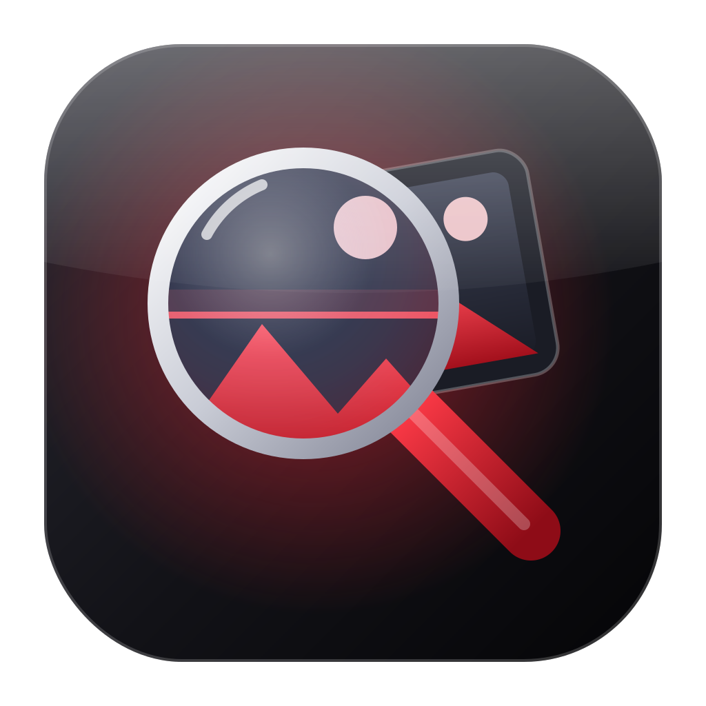

<p align="center"></p>

<h1 align="center">IBRA LENS</h1>
<p align="center">البحث الذكي عن الصور بالحاسبة — بالوصف أو بصورة، وكشف الصور المكررة</p>

<p align="center"><a href="https://github.com/ibrata2/ibra-lens/releases/latest"><b>⬇ تنزيل آخر إصدار للوندوز</b></a></p>

---

## المميزات
| | |
|---|---|
| 🔎 بحث بالوصف | اكتب «طفل»، «وشم»، «سيارة»، «بحر»… (عربي أو إنكليزي) ويطلعلك الصور حسب محتواها، مو حسب اسم الملف |
| 🖼 بحث بصورة | ارفع/اسحب صورة ويلكي نفسها ونسخها المعدلة والمشابهة إلها |
| 🧬 الصور المكررة | متطابقة تماماً أو متشابهة (مصغرة/مضغوطة)، مع تحديد تلقائي للأفضل وحذف الباقي لسلة المحذوفات |
| 📁 مكان الصورة | يفتح الفولدر ومحددة عليها الصورة |
| 🖱 قائمة الكلك اليمين | «ابحث عن مثيلها بـ IBRA LENS» على أي صورة بالوندوز |
| ⚡ أوفلاين | الذكاء الاصطناعي يشتغل على حاسبتك (كارت الشاشة إذا متوفر) |
| ⬆ تحديث تلقائي | البرنامج يبلغك بالإصدار الجديد وينصبه فوق القديم |

## شلون يشتغل
- **CLIP ViT-B/32** لتحويل كل صورة لبصمة، و**نموذج نصوص متعدد اللغات** بنفس الفضاء حتى العربي يشتغل.
- بصمة مرئية **pHash** + هاش الملف لكشف المكرر.
- الفهرس محفوظ بـ `%LOCALAPPDATA%\IBRA LENS\index.db`.

## البناء
الإصدارات تنبني تلقائياً بـ GitHub Actions عند رفع tag مثل `v1.0.1`:
تصدير النماذج إلى ONNX ← PyInstaller ← فحص ذاتي ← Inno Setup ← Releases.

تشغيل محلي للتطوير:
```bash
pip install -r requirements.txt
python run.py
```

---
برمجة و تطوير **ابراهيم الخزرجي** — [تليكرام](https://t.me/ibraprogram) • [تيك توك](https://www.tiktok.com/@ibraprogram)
